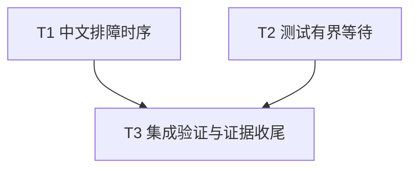

# 容量重试指引与测试有界等待修复实施计划

> **面向智能体执行者：** 使用 executing-plans 逐项执行，以复选框跟踪进度。该计划只包含两个局部修复，无需额外架构设计审批。

**目标：** 完成已采纳的 TE-001、TE-002，准确说明容量订阅时序，并使指定测试有界失败。

**架构：** 保留现有执行器与通知协议，局部修改用户指南和现有测试。无需公共 API 或下游迁移。

**技术栈：** Rust 2024、项目 Rust 1.94.0 工具链、Tokio time、Cargo 与现有 rs-infra 验证入口。

**项目目录：** `/data/working/qubit/rust-common/rs-tokio-executor`。

**设计依据：** [修复设计](design-20261109T093020145Z-0ba30ffe.md)。文件按用户指定存入项目 doc，无临时方案工作区。

## 采纳范围及约束

- TE-001（已确认，P2）：修正中文指南排障表的容量订阅顺序。
- TE-002（已确认，P2）：给指定 try_get 轮询及该用例的终止等待增加期限。
- 用户明确排除或搁置：无。待验证疑点：无。
- 在当前 Paseo workspace 中工作，不创建或打开新的 Paseo workspace。
- 以最小修复为默认，不为统一风格或潜在扩展扩大范围。验证若发现失败，允许修改必要测试及源码，包括已有基线问题；不得降低验证门槛。
- 本计划不推断提交、推送授权，未来按实施命令执行；当前方案生成阶段的只写文档边界不作为实施限制。

## 文件职责

| 文件 | 修改职责 |
| --- | --- |
| `doc/user_guide.zh_CN.md` | TE-001 排障行 |
| `tests/tokio_blocking_executor_service_tests.rs` | TE-002 原测试的局部轮询与终止等待 |
| `doc/user_guide.md`、`examples/capacity_retry_callable.rs`、`examples/capacity_retry_future.rs` | 语义对照，预期无需修改 |

验证暴露问题时扩展文件集合须记录证据；不将此表当作禁止必要 Rust 修复的清单。

## 调度图

T1、T2 无依赖且写入集合不交，属于同一可并行批次；实际执行可由同一执行者顺序完成，无须为两个小改动强制创建 agent。重型命令归 T3，统一使用当前项目 target 资源组，串行运行。

| 任务 | 前置任务 | 最小解锁产物 | 写入集合 | 本地验证 | 集成验证归属 | 审查时机 |
| --- | --- | --- | --- | --- | --- | --- |
| T1 | 无 | 已有指南与正确示例 | `doc/user_guide.zh_CN.md` | 文案与正确算法逐步核对 | T3 | 批量审查 |
| T2 | 无 | 已有目标测试及 dev time feature | `tests/tokio_blocking_executor_service_tests.rs` | 指定 Cargo 测试命令 | T3 | 批量审查 |
| T3 | T1、T2 | 两项修复已落盘且本地验证完成 | 必要的验证失败修复文件及实施记录 | 检查最终 diff | T3 独占全量 CI、文档消费者及 coverage | 立即审查 |

## 任务拓扑依赖图



## T1：中文排障订阅时序

输入：指南第101行和英文排障表的正确时序；输出：修正后的中文排障表；无接口变化。

- [ ] 检查工作树状态及当前文件内容，保留用户改动，确认本轮条目仍适用。
- [ ] 将“提交被拒绝”一行的处理方式替换为：

  首次提交前订阅容量变化；提交返回 `Saturated` 后等待通知再重试。若收到拒绝后才创建订阅，先立即重试，仍为 `Saturated` 时再等待；遇到 `Shutdown` 则结束重试。

- [ ] 对照中文正文、英文表格和两份重试示例，人工走查“先订阅→提交→仅在饱和时等待→重试”以及“晚订阅→立即重试”两条路径。确认未暗示通知预留容量。
- [ ] 检查 Markdown 表格和 diff，无须添加逐字匹配文案的测试；消费者执行由 T3 统一负责。

## T2：指定测试有界等待

输入：现有 try_get 用例；输出：保留状态和值断言、可报告超时的测试；无生产接口变化。

- [ ] 先运行现有目标测试记录基线：

  `cargo test --locked --test tokio_blocking_executor_service_tests test_tokio_blocking_task_handle_try_get_reports_pending_then_ready -- --exact`

  预期退出0。失败或挂起时保留日志，核查原因，不把基线失败视为本轮修复已完成。

- [ ] 用以下代码替换释放任务后的原 loop，使用已有 Duration 导入：

```rust
tokio::time::timeout(Duration::from_secs(5), async {
    loop {
        match handle.try_get() {
            TryGet::Ready(result) => {
                assert_eq!(result.expect("tracked task should finish"), 7);
                break;
            }
            TryGet::Pending(pending_handle) => {
                handle = pending_handle;
                tokio::task::yield_now().await;
            }
        }
    }
})
.await
.expect("released blocking task result remained Pending for 5 seconds");
```

- [ ] 仅在该用例中，将末尾 shutdown 后的无期限 wait 改为：

```rust
service.shutdown();
assert!(
    service.wait_termination_timeout(Duration::from_secs(5)),
    "blocking service did not terminate within 5 seconds after result completion"
);
```

- [ ] 重新运行上述 exact 命令，并运行 `cargo test --locked --test tokio_blocking_executor_service_tests`，均须退出0。确认释放前 Pending 与最终7的断言仍在。
- [ ] 检查 timeout 范围覆盖每个 Pending 分支，yield 保留，超时诊断明确；不为验证测试包装器另造生产公共 API。若实测同步死锁导致 timeout 无法推进，采用已有子进程 watchdog 模式做必要修复并记录实际原因。

## T3：集成验证与证据收尾

输入：T1、T2 完成；输出：可审查最终 diff、两个条目的验收记录及真实验证结果。

- [ ] 检查 `git diff --check` 与最终 diff，确认 TE-001、TE-002 均已落实，无无关重构。
- [ ] 运行 `cargo test --locked --test documentation_examples_tests`，验证双语文档消费者；预期退出0。
- [ ] 运行 `./.infra/bin/ci-check.sh`，记录实际执行的检查阶段、命令、退出码和日志位置；预期全通过。按仓库入口要求处理格式、Clippy、Rustdoc、测试等，不用单一 focused test 代替集成门禁。
- [ ] 核对 CI 日志是否执行现有 coverage 门禁；若未执行，运行 `./.infra/bin/coverage.sh`。保留当前 coverage 配置与阈值，不增加豁免或降低门槛。
- [ ] 对失败（包括已有基线问题）定位并按需新增/修改回归测试及必要源码，完成修复后重跑受影响的 focused check 和失败门禁。不得通过忽略测试、删除断言或调整覆盖率要求绕过失败。外部环境确实阻断时，记录阻断原因和未完成项，不报告全通过。
- [ ] 验收 TE-001：独立阅读表格无订阅时序歧义；验收 TE-002：保留原业务断言且轮询、局部终止等待均有5秒上限。提供实际结果与余留风险；不得宣称 timeout 能抢占同步死锁。
- [ ] 按未来实施命令的授权完成提交或远端操作；本方案生成命令本身不授权执行这些操作。

## 计划自检映射

| 必须项 | 负责任务 |
| --- | --- |
| 全部已采纳意见且无排除条目混入 | T1、T2 |
| 中文与英文、正文和示例时序一致 | T1 |
| 保留状态转换及结果断言、增加有界等待 | T2 |
| 文档消费者、CI、现有覆盖率门禁与失败修复 | T3 |
| 最终范围、授权和证据检查 | T3 |

调度表、拓扑图和任务列表均为 T1、T2、T3。当前文档只描述未来验证，没有将命令写成已执行或通过。
