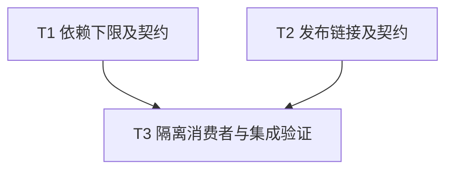

# 依赖下限与发布版 Rustdoc 链接修复实施计划

> **面向智能体执行者：** 使用 executing-plans 逐项执行，以复选框跟踪。本方案不需要额外设计审批。

**目标：** 完成 RTE-001、RTE-002，不扩大公共接口或并发实现范围。

**架构：** 保留两个 service 和本地 path 开发方式，仅修正依赖下限、发布链接并补足回归证据。

**技术栈：** Rust 2024、项目 Rust 1.94 工具链、Cargo、现有 toml/semver 测试依赖、rs-infra。

**设计依据：** [修复设计](design-20261109T103721101Z-15571165.md)。文档按用户指定直接保存在项目 doc，不另建临时方案工作区。

## 纳入范围及持续要求

- 纳入：RTE-001（已确认，P1）、RTE-002（已确认，P3）。明确搁置或拒绝：无。待验证疑点：无。
- 在当前 Paseo workspace 内工作，不创建或打开新的 Paseo workspace。
- 优先最小改动，不为统一风格或潜在扩展扩大重构。保留已有工作树改动。
- 为解决测试失败、ci-check.sh 错误或覆盖率不足，可新增或修改测试及必要源码，包括已有基线问题；保留适用仓库规则，禁止降低门槛。
- 本文是未来实施计划；本次方案生成没有执行以下命令。未来提交及远端操作按实施命令的明确授权执行。

## 文件职责

| 文件 | 职责 |
| --- | --- |
| Cargo.toml | RTE-001 依赖下限 |
| tests/dependency_contract_tests.rs（新建） | RTE-001 版本契约 |
| src/tokio_io_executor_service.rs | RTE-002 两处 Rustdoc URL |
| tests/readme_tests.rs | RTE-002 发布链接一致性回归 |
| Cargo.lock | 仅在依赖解析确有需要时最小更新，保留原有变更 |

## 调度图

T1、T2 无接口依赖且写入集合互斥，为同一并行批次；任务小，可由同一执行者顺序完成，无须强制派生 agent。重型验证仅由 T3 负责，使用同一 target 资源组串行运行。

| 任务 | 前置任务 | 最小解锁产物 | 写入集合 | 本地验证 | 集成验证归属 | 审查时机 |
| --- | --- | --- | --- | --- | --- | --- |
| T1 | 无 | 当前 manifest 和现有 dev-dependencies | Cargo.toml、tests/dependency_contract_tests.rs；必要时 Cargo.lock | cargo test --locked --test dependency_contract_tests | T3 | 立即审查 |
| T2 | 无 | 当前 crate 版本与 IO Rustdoc | src/tokio_io_executor_service.rs、tests/readme_tests.rs | cargo test --locked --test readme_tests | T3 | 批量审查 |
| T3 | T1、T2 | 两项修复与 focused 结果 | 必要的验证失败修复文件及验证记录 | 隔离消费者、最终 diff | T3：CI、coverage、下游契约 | 立即审查 |

## 任务拓扑依赖图



## T1：依赖下限

输入：Cargo.toml 当前依赖；输出：允许的 qubit-executor 版本从 0.9.1 开始，无新 API。

- [ ] 记录 git status、当前 diff 和测试基线，保留已有改动；核对项目及父目录适用规则。
- [ ] 新建 tests/dependency_contract_tests.rs（采用现有文件头）：

```rust
#[test]
fn test_executor_requirement_excludes_unsupported_release() {
    let manifest: toml::Value = include_str!("../Cargo.toml").parse().unwrap();
    let requirement = manifest["dependencies"]["qubit-executor"]["version"].as_str().unwrap();
    let requirement = semver::VersionReq::parse(requirement).unwrap();
    assert!(!requirement.matches(&semver::Version::new(0, 9, 0)));
    assert!(requirement.matches(&semver::Version::new(0, 9, 1)));
}
```

- [ ] 运行 `cargo test --locked --test dependency_contract_tests`，当前 ^0.9 应在排除 0.9.0 断言失败；其他失败先定位，不能当作预期红灯。
- [ ] 将唯一对应依赖行改为：

```toml
qubit-executor = { version = "^0.9.1", path = "../rs-executor" }
```

- [ ] 重跑该 focused 命令，预期退出 0；若 lock 必须更新，仅更新必要解析，不批量升级依赖。

## T2：发布链接

输入：Cargo.toml 版本 0.12.0；输出：IO 构造函数的文档引用固定相同版本。

- [ ] 在 tests/readme_tests.rs 添加以下测试，沿用已有 read_project_file 和 package_version helper：

```rust
#[test]
fn test_io_runtime_guide_links_are_release_pinned() {
    let source = read_project_file("src/tokio_io_executor_service.rs");
    let version = package_version();
    let expected = format!(
        "https://github.com/qubit-ltd/rs-tokio-executor/blob/v{version}/doc/user_guide.md#runtime-lifetime-and-driver-progress"
    );
    assert_eq!(source.matches(&expected).count(), 2);
    assert!(!source.contains("https://github.com/qubit-ltd/rs-tokio-executor/blob/main/doc/"));
}
```

- [ ] 运行 `cargo test --locked --test readme_tests test_io_runtime_guide_links_are_release_pinned -- --exact`，预期当前链接导致失败。
- [ ] 将 src/tokio_io_executor_service.rs 两处 runtime guide URL 的 `blob/main/` 改为 `blob/v0.12.0/`，其余语义不变。
- [ ] 运行 `cargo test --locked --test readme_tests`，预期退出 0；检索 src 全树本仓库 blob/main/doc/ 引用，预期无匹配。若另有匹配，判断是否同类发布指南引用后最小修正，不批量改外部网站链接。

## T3：隔离消费者与集成验证

输入：T1、T2；输出：两个编号的真实验证记录。

- [ ] 检查最终 diff 与 `git diff --check`；确认原有 .infra 等改动未被覆盖。
- [ ] 在仓库外用 Python tempfile 创建唯一临时目录，记录绝对路径；复制修复后的 Cargo.toml、src、README.md、LICENSE 到 candidate 子目录。只在副本中删除依赖行的 `, path = "../rs-executor"`，确认副本不含该 path。消费者 Cargo.toml 如下，candidate 与 consumer 同在该临时目录：

```toml
[package]
name = "tokio-executor-minimum-consumer"
version = "0.0.0"
edition = "2024"

[dependencies]
qubit-tokio-executor = { path = "../candidate" }
qubit-executor = "=0.9.1"
```

- [ ] consumer/src/main.rs 写入：

```rust
use qubit_executor::CancellableTaskHandle;
use qubit_tokio_executor::TokioBlockingTaskHandle;
fn requires_cancellation<T: CancellableTaskHandle<(), std::io::Error>>() {}
fn main() {
    requires_cancellation::<TokioBlockingTaskHandle<(), std::io::Error>>();
}
```

- [ ] 从该临时目录执行 `cargo check --manifest-path consumer/Cargo.toml` 首次生成其独立锁文件，再执行 `cargo check --locked --manifest-path consumer/Cargo.toml`，预期均退出 0。运行 `cargo tree --locked --manifest-path consumer/Cargo.toml -i qubit-executor`，确认唯一版本为 registry 0.9.1，无本地 path/patch 替代。使用独立 CARGO_TARGET_DIR，避免污染目标项目。版本不可用或网络失败则记录外部阻断，不能静默换成其他版本后称下限验证成功。
- [ ] 运行 `cargo test --locked --test documentation_examples_tests`，验证四份双语用户文档的消费者，预期退出 0。
- [ ] 运行 `./.infra/bin/ci-check.sh`，记录实际覆盖的格式、Clippy、Rustdoc、测试等检查及退出码，预期全通过。Rustdoc 本地构建不证明远端发布标签可达。
- [ ] 核对 CI 是否包含现有 coverage 门禁；未包含则运行 `./.infra/bin/coverage.sh`，保留原阈值，预期通过。
- [ ] 在 `/data/working/qubit/rust-common/rs-executor` 执行 `cargo test --locked --manifest-path tests/adapter_contracts/Cargo.toml`，核对 fixture 实际使用当前 Tokio 项目。对 rs-execution-services 和 rs-execution-services-impl 的依赖声明及取消/容量等待调用作对照；默认不需要下游源码迁移。若 fixture 锁定或环境阻断，明确报告，不能宣称契约已通过。
- [ ] 对失败（包括已有基线问题）定位原因，按需新增/修改回归测试与必要源码后重跑受影响门禁；不删除断言、不忽略用例、不降低覆盖率、不新增豁免绕过失败。记录范围扩展依据。
- [ ] 汇总 RTE-001 依赖声明、最低版本消费者证据；RTE-002 两处链接与一致性测试证据；所有命令、退出码和未完成项。只清理本次创建且路径核验无误的临时消费者目录。提交或远端操作依未来实施命令授权处理。

## 计划自检映射

| 必须项 | 任务 |
| --- | --- |
| 全部纳入条目、无额外重构 | T1、T2 |
| 声明下限和真实 registry 消费者验证 | T1、T3 |
| 两处版本链接及回归 | T2 |
| 保留用户改动、双语文档消费者、CI、coverage、下游契约 | T3 |
| 验证失败可修复、门槛不降低、真实交付证据 | T3 |

调度表、拓扑图和任务列表使用相同的 T1、T2、T3。此文仅描述未来工作，没有将预期结果写为已完成。
